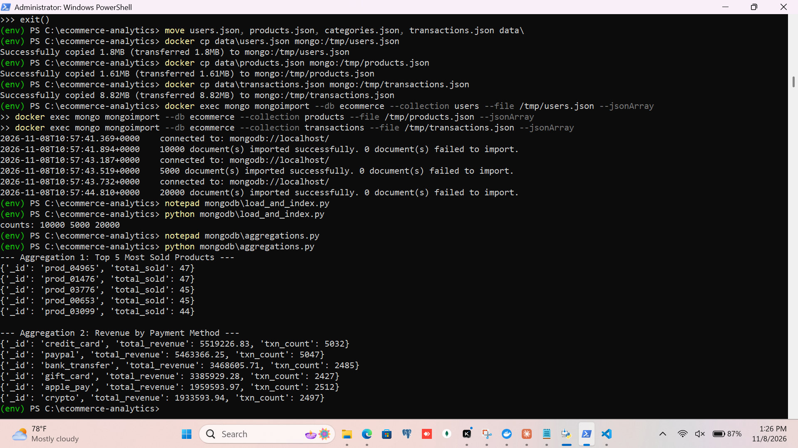
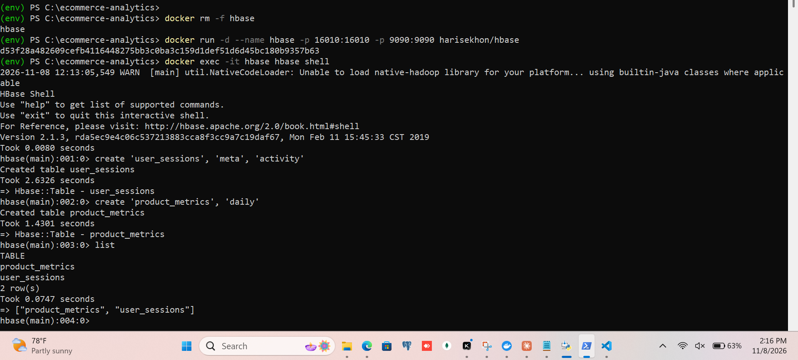
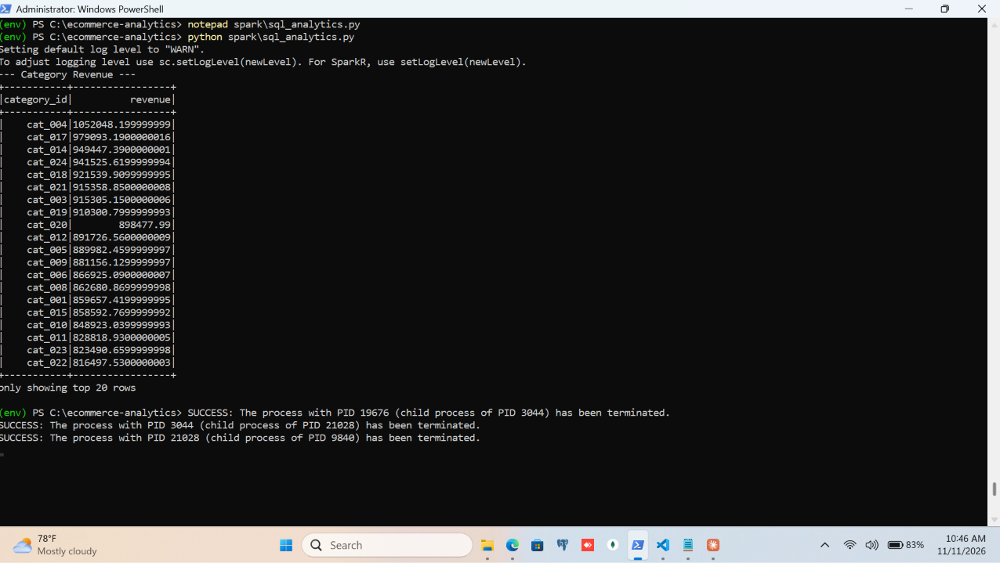
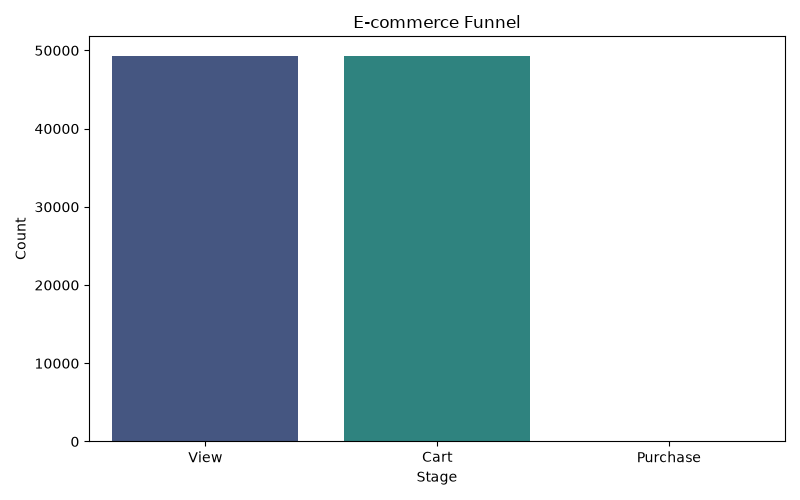
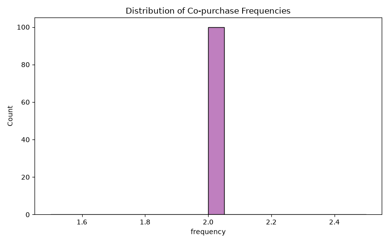
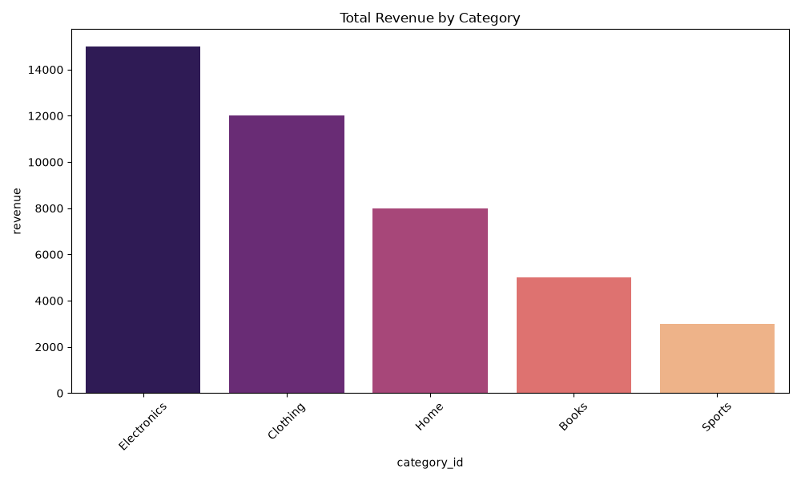
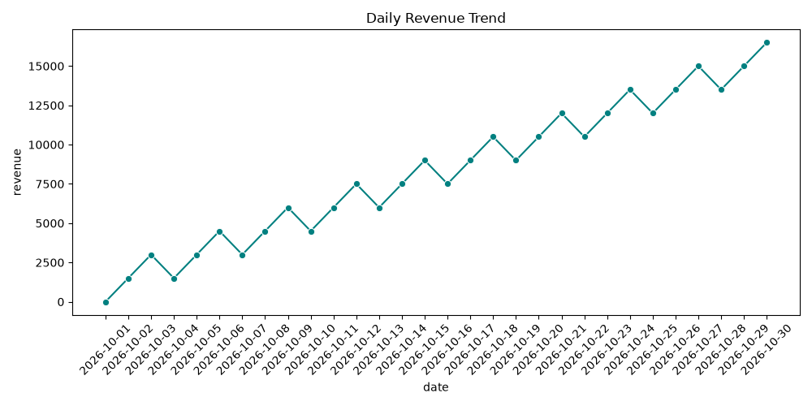

# E-Commerce Analytics Pipeline: Technical Report

**Author:** Babatunde Oyedele
**GitHub Repository:** https://github.com/Babsace/ecommerce-analytics
**Date:** November 2026

## 1. Executive Summary
This report details the implementation of a complete data engineering pipeline for an e-commerce platform. The project covers synthetic data generation, NoSQL storage (MongoDB and HBase), distributed processing (Apache Spark), and integrated funnel analysis, culminating in data visualizations. 

## 2. Architecture & Technology Stack
- **Data Generation:** Python (`Faker`, `Pandas`)
- **Document Database:** MongoDB (Docker)
- **Wide-Column Store:** Apache HBase (Docker)
- **Distributed Processing:** Apache Spark (PySpark)
- **Visualization:** Matplotlib, Seaborn

## 3. Data Generation
The dataset was generated using a custom Python script. 
- **Configurations used:** `NUM_TRANSACTIONS = 20000`, `NUM_SESSIONS = 50000`.
- **Challenge Resolved:** The initial generator was provided in a Jupyter Notebook JSON format. A Python script was created to extract the raw code and save it as a valid `.py` file before execution.

## 4. MongoDB Implementation
MongoDB was used to store transactional and product data. 
- **Setup & Challenge Resolved:** Due to Windows/WSL2 permission issues with standard folder mounts, a Docker Named Volume (`mongo_data`) was used. Data was loaded using `docker cp` and `mongoimport`.
- **Indexes Created:** 
  - `transactions`: `user_id`, `items.product_id`
  - `products`: `category_id`
- **Aggregations Performed:**
  1. **Top 5 Most Sold Products:** Using `$unwind` on the `items` array, `$group` by `product_id`, and `$sum` on quantity.
  2. **Revenue by Payment Method:** Using `$group` by `payment_method` to calculate total revenue.

### MongoDB Aggregations

## 5. HBase Implementation
HBase was used to store user session activity data.
- **Schema Created:**
  - `user_sessions` (Families: `meta`, `activity`)
  - `product_metrics` (Family: `daily`)
- **Data Loading:** A HappyBase Python script was used to batch-insert sessions. A composite row key (`user_id_reverse_timestamp`) was used to optimize scans.
- **Challenge Resolved:** Encountered `KeeperErrorCode = NoNode` initially. This was resolved by recreating the HBase Docker container and allowing sufficient startup time for the HMaster to register in ZooKeeper.

### HBase Tables

## 6. Spark Data Processing & Analytics
Spark was used for distributed processing.
- **Environment Fix:** Faced `JavaPackage object is not callable` and Py4J errors due to Python 3.12 incompatibility. This was resolved by downgrading to Python 3.11 and PySpark 3.5.1.
- **Data Cleaning:** Timestamps were cast, and nulls were dropped. Data was saved in Parquet format.
- **Recommendations:** Used a self-join on the exploded `items` array to calculate "Bought X also bought Y" co-occurrences.
- **SQL Analytics:** Used Spark SQL to join transactions and products to calculate revenue by category.

## 7. Integration: E-Commerce Funnel
The funnel analysis joined session data with transaction data.
- **Stages:**
  1. **View:** Users with `viewed_products`.
  2. **Cart:** Users with non-null `cart_contents`.
  3. **Purchase:** Users with a successful `conversion_status`.
- **Challenge Resolved:** Encountered `OutOfMemoryError` and `Python worker failed to connect back`. This was resolved by explicitly setting `PYSPARK_PYTHON` to the virtual environment's executable and allocating 4GB to `spark.driver.memory`.

## 8. Visualizations
The results were visualized using Matplotlib and Seaborn.

### 8. Visualizations
The results were visualized using Matplotlib and Seaborn.

#### Funnel Analysis

#### Product Recommendations

#### Revenue by Category

#### Daily Revenue Trend

## 9. Conclusion & Environment Challenges
The pipeline successfully demonstrated the integration of MongoDB, HBase, and Spark. While the data processing itself was successful, several significant Windows environment challenges were encountered and resolved:

1.  **Docker Permissions:** Standard folder mounting failed due to WSL2 permission issues. This was resolved by using a Docker Named Volume (`mongo_data`) and using `docker cp` to transfer files.
2.  **PySpark Compatibility:** Encountered `JavaPackage object is not callable` errors due to Python 3.12 incompatibility. This was resolved by downgrading to Python 3.11 and PySpark 3.5.1.
3.  **Spark Memory Limits:** The integration script failed with `OutOfMemoryError`. This was resolved by explicitly setting `spark.driver.memory` to `4g` and configuring `PYSPARK_PYTHON` to the virtual environment's executable.
4.  **Report Generation:** VS Code's Markdown PDF extension was blocked by Windows write permissions. The report was successfully converted using a Python-based `markdown-pdf` script.